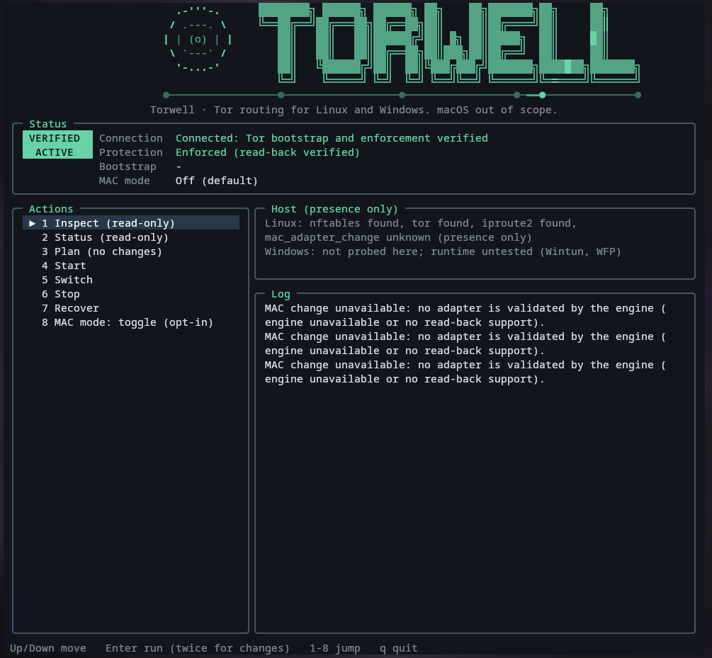

# Torwell

**English** · [Türkçe](README.tr.md)

Route all of your computer's traffic through Tor, safely. A modern, Rust successor to
[TorGhost](https://github.com/SusmithKrishnan/torghost) with a terminal interface.



## What it does

- Sends all TCP and DNS traffic through Tor.
- **Fails closed:** anything that cannot go through Tor (IPv6, other UDP, connections
  opened before start) is blocked. If something breaks, traffic stays blocked instead of
  leaking.
- **Cleanly reversible:** touches only its own firewall table. Stop puts your network back
  exactly as it was. Your existing firewall rules are never flushed.
- Shows "connected" only when it has verified both Tor and the firewall.
- Optional MAC address randomization (off by default).

## Install

Linux x86_64 (developed on Arch/CachyOS):

```sh
curl -fsSL https://raw.githubusercontent.com/se7enbyte/torwell/main/install.sh | sh
```

The installer adds `tor`, `nftables` and `polkit` with your package manager and installs
Torwell (checksum verified). *Note: the first release (v0.1.0) is being prepared; until
then, build from source, see [docs/ARCHITECTURE.md](docs/ARCHITECTURE.md#building).*

## Use

```sh
torwell-ui
```

| Key | Action |
|---|---|
| `4` then Enter | **Start**: route everything through Tor (asks for your password) |
| `2` | **Status**: check the connection |
| `5` then Enter | **Switch**: get a new Tor identity |
| `6` then Enter | **Stop**: back to your normal connection |
| `q` | Quit the interface (Torwell keeps running) |

Check it works: `curl -s https://check.torproject.org/api/ip` should show `"IsTor":true`.

## Good to know

- **Tor alone does not make you anonymous.** Logins, browser fingerprints and your
  behaviour can still identify you.
- **Your local network is blocked while Torwell is on**: printers, NAS, Deskflow/KVM
  sharing, local game servers.
- **After a reboot, Torwell is off** unless you run
  `sudo torwell-engine boot-protection enable`.
- If your connection ever gets stuck, use **Stop** or **Recover** in the interface. Last
  resort:
  ```sh
  sudo nft delete table inet torwell; sudo systemctl stop torwell-tor.service; sudo rm -r /var/lib/torwell
  ```
- Uninstall: `curl -fsSL https://raw.githubusercontent.com/se7enbyte/torwell/main/install.sh | sh -s -- --uninstall`

## Status

Early development. Works end to end on CachyOS. Windows: code exists, never run, not
supported. macOS: not planned.

How it works, building from source and test details:
[docs/ARCHITECTURE.md](docs/ARCHITECTURE.md).

## License

[GPL-3.0-or-later](LICENSE).
