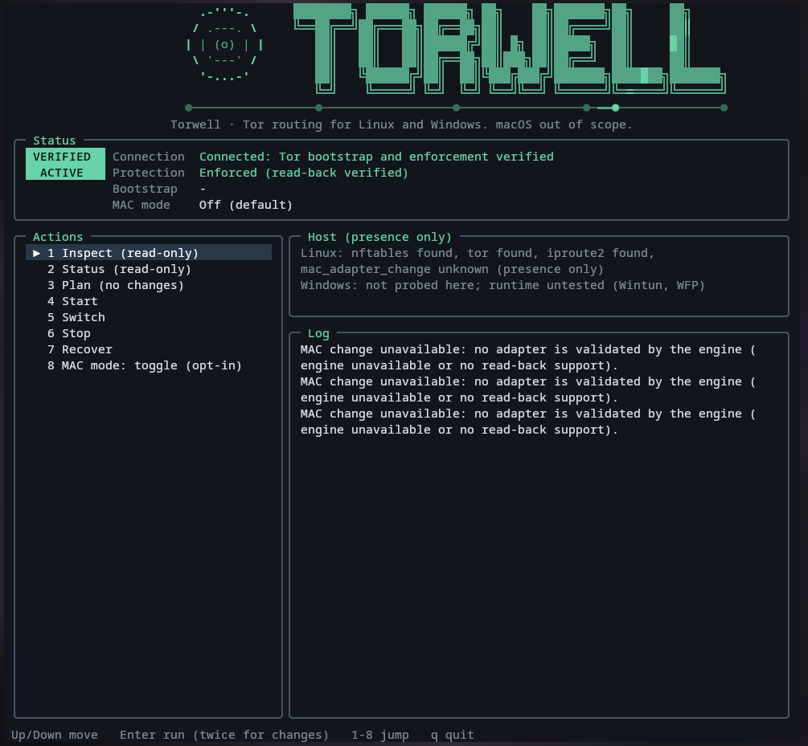

# Torwell

[English](README.md) · **Türkçe**

Bilgisayarının tüm trafiğini güvenli şekilde Tor üzerinden geçirir.
[TorGhost](https://github.com/SusmithKrishnan/torghost)'un Rust ile yazılmış, terminal
arayüzlü modern halefi.



## Ne yapar

- Tüm TCP ve DNS trafiğini Tor'dan geçirir.
- **Hata olursa kapalı kalır:** Tor'dan geçemeyen her şey (IPv6, diğer UDP, başlatmadan
  önce açılmış bağlantılar, sanal makine ve konteyner trafiği) engellenir. Bir şey bozulursa trafik sızmaz, engelli kalır.
- **Temiz geri alınır:** yalnızca kendi güvenlik duvarı tablosuna dokunur. Stop, ağını
  tam eski haline döndürür. Mevcut güvenlik duvarı kuralların asla silinmez.
- "Bağlı" yazısını yalnızca hem Tor'u hem güvenlik duvarını doğruladıktan sonra gösterir.
- İsteğe bağlı MAC adresi değiştirme (varsayılan olarak kapalı).

## Kurulum

Linux x86_64 (Arch/CachyOS üzerinde geliştirildi):

```sh
curl -fsSL https://raw.githubusercontent.com/se7enbyte/torwell/main/install.sh | sh
```

Kurulum betiği `tor`, `nftables` ve `polkit`'i paket yöneticinle kurar, ardından
Torwell'i (özet doğrulamasıyla) yükler. *Not: ilk sürüm (v0.1.0) hazırlanıyor; o zamana
kadar kaynaktan derlemek gerekiyor, bkz. [docs/ARCHITECTURE.md](docs/ARCHITECTURE.md#building).*

## Kullanım

```sh
torwell-ui
```

| Tuş | İşlem |
|---|---|
| `4` sonra Enter | **Start**: her şeyi Tor'dan geçir (şifre sorar) |
| `2` | **Status**: bağlantıyı kontrol et |
| `5` sonra Enter | **Switch**: yeni Tor kimliği al |
| `6` sonra Enter | **Stop**: normal bağlantına dön |
| `q` | Arayüzden çık (Torwell çalışmaya devam eder) |

Çalıştığını kontrol et: `curl -s https://check.torproject.org/api/ip` komutu
`"IsTor":true` göstermeli.

## Bilmen gerekenler

Neyin korunup neyin korunmadığının tam listesi (İngilizce): [docs/THREAT_MODEL.md](docs/THREAT_MODEL.md).

- **Tor tek başına seni anonim yapmaz.** Hesap girişlerin, tarayıcı parmak izin ve
  davranışların seni yine de tanıtabilir.
- **Torwell açıkken yerel ağın engellidir:** yazıcı, NAS, Deskflow/KVM paylaşımı, yerel
  oyun sunucuları çalışmaz.
- **Yeniden başlatınca Torwell kapalı gelir**, eğer
  `sudo torwell-engine boot-protection enable` çalıştırmadıysan.
- Bağlantın takılı kalırsa arayüzde **Stop** ya da **Recover** kullan. Son çare:
  ```sh
  sudo nft delete table inet torwell; sudo systemctl stop torwell-tor.service; sudo rm -r /var/lib/torwell
  ```
- Kaldırma: `curl -fsSL https://raw.githubusercontent.com/se7enbyte/torwell/main/install.sh | sh -s -- --uninstall`

## Durum

Erken geliştirme aşamasında. CachyOS'ta uçtan uca çalışıyor. Windows: kodu var, hiç
çalıştırılmadı, desteklenmiyor. macOS: planlanmıyor.

Nasıl çalıştığı, kaynaktan derleme ve test ayrıntıları (İngilizce):
[docs/ARCHITECTURE.md](docs/ARCHITECTURE.md).

## Lisans

[GPL-3.0-or-later](LICENSE).
